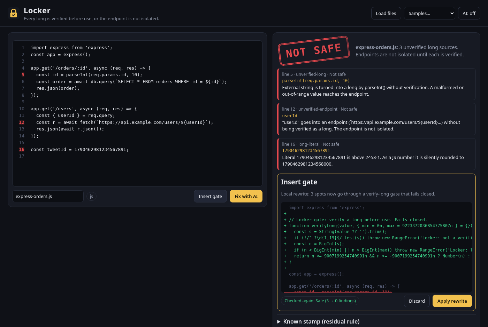

# Locker

**Every long is verified before use, or the endpoint is not isolated.**

Locker checks source in a static sandbox (nothing is executed). A long integer, or a string that is really a long (ids, account numbers, amounts, serials), has to be verified before it is used. That check is what isolates the endpoint. If the source skips it, the stamp says **Not safe**.



## What it does

- **Paste code, load files, or start from the samples** (Express, Flask, Java, Go, C, a safe example, and the known stamp).
- **Stamp**: `Safe`, `Not safe` or `Review`, with each finding on its line:
  - `unverified-long`: an external string (request params/query/body, argv, env, stdin, URL params, form values…) is turned into an integer by `parseInt`/`Number`/`BigInt`, `int()`, `Long.parseLong`, `strconv.Atoi/ParseInt`, `atoi/atol/strtol` without a format/range check, a caught parse error, or a checked `err`/`errno`.
  - `unverified-endpoint`: an external value goes straight into a URL, path or SQL string.
  - `long-literal` (JS): a numeric literal above 2^53−1 that JavaScript silently rounds.
  - `json-long` (JS, review): `JSON.parse` near id fields, where long ids become rounded numbers.
- **Insert gate**: a local, deterministic rewrite. Each unsafe spot goes through a `verifyLong` gate (per language: `verifyLong`, `verify_long`, `LockerGate.verifyLong`, `lockerVerifyInt64` + `lockerMust`, `locker_verify_long`) that checks digits, length and range and **fails closed**, so a failed check never reaches the endpoint. The rewrite is checked again and shown as a diff before you apply it.
- **Fix with AI (optional, pluggable)**: no key is required. With nothing configured it falls back to Insert gate. You can point it at any OpenAI-compatible chat-completions endpoint (URL, model, key stored only in your browser), or a page can register `window.LockerAI = { fix(source, findings, language) }`. Whatever comes back is checked again; if it still has unverified longs, Locker gates it.
- **Known stamp**: the residual rule from the chat: null and zero-b are −1, aligned 1 is 0, aligned 3 is 2. Open parallel and every long goes out of date: read refuses it. Close parallel and the residuals refresh. (Panel in the UI, `knownStamp` + `ResidualStore` in the core.)
- **Share card**: downloads a 1200×630 PNG of the current verdict.
- **CLI** for CI: `node bin/locker.mjs src/**/*.js` exits 1 when anything is Not safe; `--gate --write` rewrites files in place; `--json` for machine output.

## Run it

No build, no dependencies.

```sh
python3 -m http.server 8080     # or any static server; ES modules need http://, not file://
open http://localhost:8080
npm test                        # node --test (Node 18+)
node bin/locker.mjs samples/…   # CLI
```

URL options: `?sample=flask_accounts.py` opens a sample, `&gate=1` runs Insert gate immediately.

Deploy: it is a static site. `.github/workflows/pages.yml` publishes the repo root to GitHub Pages on push to `main` (enable Pages → "GitHub Actions" in repo settings).

## Choices made where the idea was open

- "Checked in its sandbox" = static analysis in the browser; Locker never runs your code.
- Detection is heuristic (regex + light taint tracking of variables assigned from external sources, verification hints within ±3 lines). It is a linter, not a proof. Supported: JS/TS, Python, Java, Go, C.
- The known-stamp rule came from an attached `axb_residual_known.zip` that is not in the chat capture, so it is implemented exactly as the chat text states and nothing more.
- AI is off by default so the app works with no account, key or network.

## Origin

Built from Joshua Almeida's Grok chat "I want to build an app called locker" (https://grok.com/c/be8ead52-c6cd-4841-afb7-d9e99bb89dfb, Oct 4, 2026).

## License

MIT, see [LICENSE](LICENSE).
